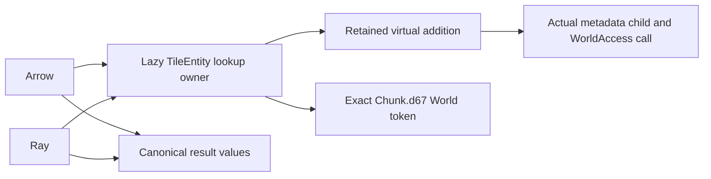

# Retained lazy Furnace lookup

A lazy client Chunk TileEntity lookup now runs the complete Furnace addition through
one retained invocation. Its inherited factory and installation finish before
orientation. A successful call closes its exact evaluated World occurrence and
retires the owner before the Chunk Map reread. A failed call keeps its reached
prefix, typed child and remaining native rights until checked cleanup succeeds.

## Source order and defining graphs

The paired original client/server bodies read the absent Map entry, cell ID,
TileEntity flag and Block array entry before capturing Chunk.d at67. Virtual
Block addition89 runs the inherited factory15 and World installation18, then
Furnace orientation15. The four neighbor reads precede the fresh, short-circuited
opacity reads and metadata write150. Map reread98 and invalidity/removal follow
only a completed addition. Native cleanup executes none of those Source calls.

The defining World code graph, lookup Registry and factory classes remain
independent explicit inputs. The retained mutation entry stores the latter two
for this virtual addition. It does not derive them from mutable Chunk.d, the
returned TileEntity or an error record. A missing factory retains its actual
reached failure. Loaded Map hits allocate no lazy owner and do not inspect
unused defining namespaces.

## Lifetime and native cleanup

Arrow stores a lazy-lookup owner outside its reused scratch union. Ray stores
its own owner beside the collision scratch. Neither pointer is placed in the
copyable canonical result, which continues to carry only acquisition selections,
pending outcomes and published close records.

A live failed owner refuses another Source lookup without resetting the first
error, output or canonical result. Native unwind captures the actual protected
producer and completes pending work for the checked current token. Only an
explicit published close or a typed child proving that exact token may close a
descendant. An unrelated token refuses cleanup and leaves the owner intact.
Ray exposes a native-only unwind step so Arrow can drain the Ray's child before
retiring Ray scratch. Ray never pops its borrowed initiating token.

A non-OK pop can already have consumed its token while retaining the producer.
The lazy owner records that call's exact slot/generation poststate and does not
pop it again. Typed outward borrows expire before child retirement. Arrow copies
an actual exception name before a producer can retire; Ray's protected name
borrow remains valid through checked Ray retirement.

An actual metadata WorldAccess exception takes priority over a later native
cleanup refusal. Classification selects the retained child, matches its first
cause, then proves the same receipt tuple and callback cause under a protected
lease. A native callback failure receives no Source Throwable label. The
TC.h150 caller site is preserved beside TC.c15 when a fresh World child has no
deeper Block-hook frame of its own.

## Native controls

Four public profiles cover direct Arrow helpers and the full Ray body, with
both state-shape and movement-box paths. They author distinct captured Block36
and stored cell61/62 operands in real saved/loaded Chunks. Ray uses separate
explicit defining graphs to reach that boundary. These are declared native
integration inputs, not an observed original Block race or a complete SL tick.

Fresh success covers the four orientations, the both-opaque default, both
Furnace variants and both shape paths. Loaded Furnace remains an ordinary false
MovingPiston type check. The genuine loaded Piston's identity and fields remain
unchanged. Late metadata failures preserve the already installed Furnace and
metadata, retain the actual child and producer, refuse an unrelated native
scope, then finish cleanup after only that structural fault is corrected.
Provider-entry counts, Map/list/owner counts and Source fields stay unchanged
during native retries. Arrow controls compare its base/private fields, bounds,
watcher record and own Random field by field through final parent retirement.

The controlled predecessor rejects Arrow and Ray's actual Source-exception
assertions; the corrected native profiles complete checked cleanup with empty
stderr under GCC and Clang sanitizers. Early assertion-abort captures remain
separate from successful cohorts. The strict reader preserves the real one- or
two-Registry initialization output, exact case ordering, complete bounded pipes,
positive completion and unchanged authored save bytes. It permits only the
actual eight-byte session lock to be added. Five portable decoder control groups
also pass normally and optimized on Windows and WSL.

The complete Windows Release build and all 1,341 configured tests pass in
618.75 seconds. The log audit matches every configured name and ID, complete
unique ordinals and Start/completion joins, with no skips or unrun cases. All
1,335 preceding Furnace names remain, with exactly six additions. GCC passes
27 selected tests in 694.88 seconds and Clang passes 28 in 681.40 seconds with
ASan, UBSan and leak detection. These batches include the server prefix,
Furnace controls and twelve shared lookup/Arrow/Ray regressions. The direct
factory-failure snapshot uses the validated current token's existing lease,
so inspection is valid in the expected FAILED state.

The final monitor-2 SDK cycles pass 9,113 Furnace, 1,723 Chest-placement and
2,052 Workbench checks. Each process preserves all 2,344 selected fingerprints
and imported assets, completes its ordinary save/reload or save boundary, and
closes its source windows. The four Furnace images were inspected. Its saved
Furnace has Burn1396/Cook5 and Player Iron in slot8; those values belong to this
process. The separate original readback packet uses the earlier scene's
Burn1397/Cook4 save and does not inherit later native-source qualification.
OpenAL uses its null driver; these controls establish no original pixels,
audible output or gameplay FPS.

The server lazy route preserves its inherited factory and World installation
before the explicit private orientation refusal at LZ.c15. A native server
control checks the installed empty Furnace, unchanged cell/metadata, exact
provider entries and repeated native cleanup without replaying Source work.
The complete server orientation remains unfinished.
Selected-loader failure during orientation, mutation between individual opacity
loads, an original dynamic Block race and a complete SL caller remain separate
qualification work. Ordinary placement, screens and saves retain their own
[Furnace record](../client/furnaces.md); this finite owner closure does not
establish unrestricted gameplay, audiovisual equality, multiplayer or FPS.
