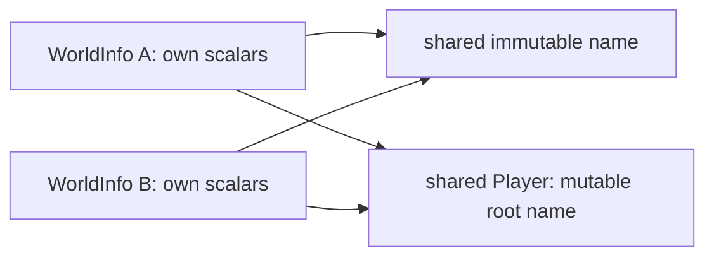

# WorldInfo ownership

`mc_world_info` implements the original client `ei` / server `ct` metadata
record. Its [interface](../../include/mc/world/info/info.h) and implementation
live under `world/info`; the library depends on storage and the private platform
clock. It initializes no World, provider, registry, display or Java runtime.
The existing loaded-world runtime and store have not yet been connected to it.

Each WorldInfo has thirteen scalar cells and two nullable references: name and
Player compound. A copy has independent scalar cells and retains the same two
references. Sharing a save handler does not make two Worlds share one live
WorldInfo. The store's current `mc_level_info` remains its separate, expiring
persistence view.

## Construction and references

Allocate a stable RAW owner, then enter one fresh, NBT or copy constructor.
Fresh construction stores only seed and the exact supplied nullable name.
NBT construction consumes the inner Data compound, writes fields in original
order, publishes Player, then reads its Dimension into a separate cached cell.
A wrong Dimension therefore leaves Player assigned in the failed owner. Copy
construction copies the cached dimension without reading Player again.
Reached failures latch FAILED_CONSTRUCTION and retain completed stores; they
cannot be retried. A failed owner must not become an enclosing World's metadata.

Names preserve UTF-16 code units and identity. NULL differs from a nonnull empty
name, and equal text does not merge identities. Name replacement retains the
new identity before releasing the old. Client Player replacement accepts NULL
and never refreshes the cached dimension; the corresponding server operation
returns UNSUPPORTED_OPERATION because that method is absent there.

Native ownership conversions are separate from those constructors:

- `name_copy` creates a distinct immutable name identity.
- `player_copy` retains an independent immutable child tree and a stable mutable
  root/name overlay. Its base-tag name getter returns the shared empty literal
  for a NULL raw name; an explicitly supplied empty name keeps its identity.
- `data_copy` retains the original inner Data tree, including unknown values,
  types, order and raw floating bits. Its selected name/Player handles can be
  used by multiple constructors. Typed Data reference setters assign existing
  handles, preserving aliases across fresh and NBT construction. Player
  assignment renames that same compound to the shared Player key literal.

Immutable source provenance remains a historical view when the selected live
references change. It is not the live Player root after a rename. Copies retain
the provenance owner as an additional native lifetime operation; the original
copy constructor does not deep-copy or preserve a Data tree.

All owners use explicit native holds and exclusive access. Independent holds
keep old references alive across replacement and Info retirement. Ownership
copies check their heap budgets, including tree, wrappers and name storage;
validation scratch and retained storage occupy separate phases. Hold overflow,
allocation and admission failures are explicit native policies. No atomic
synchronization, Java GC or allocation-failure equivalence is claimed.

## No-list serialization

`record_create` executes the no-list serializer and returns a stable inner Data
record. It allocates the destination, captures the current Player reference,
then writes seed, spawn, Time and SizeOnDisk. One real wall-clock sample supplies
output LastPlayed. It then writes name, version and weather, and finally renames
and inserts the captured same Player root. The record holds the actual name and
Player identities after its Info retires; `record_name` exposes the identity
supplying the LevelName span.

Serialization does not change live LastPlayed, cached dimension or Info.player.
It does not inspect Player.Dimension, force version 19132, preserve unknown Data
children or create an outer root/Data envelope. A nonnull empty name succeeds.
A NULL name fails at LevelName after the clock point and before Player rename.
The native output pointer remains unchanged on failure. Later codec failure
cannot undo an already completed shared Player rename.

The borrowed record can be passed to the generic NBT codec while its references
remain live and exclusive. Normal writing has the codec's documented NaN/list
canonicalization. Insertion order represents the source put sequence; it does
not reproduce Java HashMap byte traversal order.

The live-player-list serializer, mutable Player children, player simulation,
World construction and typed persistence/accounting integration remain open.
The store's existing opaque-Player pointer guard stays intact; an independently
owned Player requires a concrete typed save path. The storage schema builder
also validates Dimension and accepts an explicit timestamp, so it cannot stand
in for this original serializer. [Reference evidence](../reference/world-info.md)
records the tested scope and reproduction steps.
